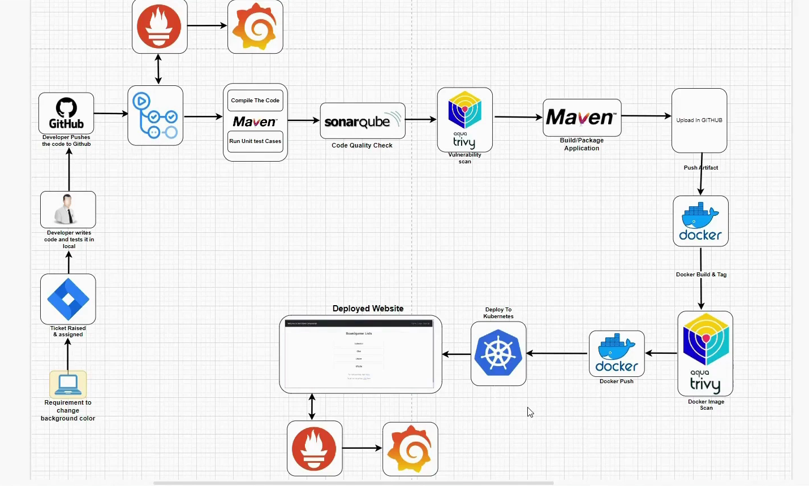
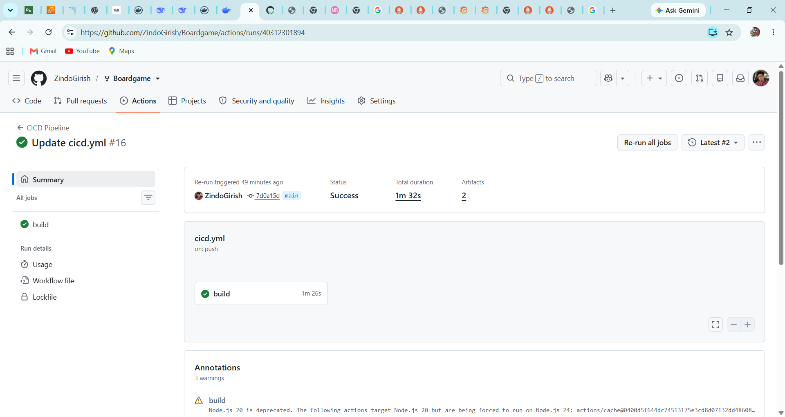

# end-to-end-devops-cicd-pipeline-using-github-actions
Automated CI/CD pipeline using GitHub Actions, Docker, Kubernetes, SonarQube, and Trivy, with monitoring using Prometheus and Grafana.

## Project Overview

This project demonstrates an end-to-end CI/CD pipeline that automates the process of building, testing, scanning, packaging, and deploying an application using DevOps tools.

The workflow starts when a developer pushes code to GitHub. The pipeline then performs build and unit testing, checks code quality with SonarQube, scans for vulnerabilities using Trivy, packages the application with Maven, and builds and scans a Docker image before deploying the application to Kubernetes.

Prometheus and Grafana are used for monitoring and visualization.

## Architecture



The architecture diagram illustrates the flow from code changes and ticket assignment through CI/CD automation, security checks, containerization, Kubernetes deployment, and monitoring.

## Tools and Technologies

| Tool | Purpose |
|---|---|
| Git & GitHub | Source code management and version control |
| GitHub Actions | CI/CD workflow automation |
| Maven | Build, dependency management, and unit testing |
| SonarQube | Code quality analysis |
| Trivy | Filesystem and container image vulnerability scanning |
| Docker | Application containerization |
| Kubernetes | Application deployment and orchestration |
| Prometheus | Metrics collection and monitoring |
| Grafana | Monitoring dashboards and visualization |

## CI/CD Pipeline Workflow

### 1. Code Development and Version Control
The developer writes and tests code locally, raises or works on a ticket, and pushes changes to GitHub.

### 2. CI/CD Pipeline Trigger
A GitHub Actions workflow automates the pipeline when the configured GitHub event occurs.

### 3. Build and Unit Testing
Maven compiles the application, manages dependencies, and runs unit tests to identify build or test failures.

### 4. Code Quality Analysis
SonarQube analyzes the source code for maintainability issues, bugs, and code-quality problems.

### 5. Vulnerability Scanning
Trivy scans the relevant source files and dependencies for known vulnerabilities.

### 6. Application Packaging
Maven packages the application into a build artifact for the next stage of the pipeline.

### 7. Docker Image Build
Docker packages the application and its runtime dependencies into a container image.

### 8. Container Image Security Scan
Trivy scans the Docker image for known vulnerabilities before deployment.

### 9. Kubernetes Deployment
The container image is used to deploy the application to a Kubernetes environment, where Kubernetes manages the application workloads.

### 10. Monitoring and Visualization
Prometheus collects configured metrics, and Grafana displays monitoring information through dashboards.

## Key Features

- Automated CI/CD workflow using GitHub Actions
- Application build and unit testing with Maven
- Static code quality analysis using SonarQube
- Vulnerability scanning using Trivy
- Docker-based application containerization
- Kubernetes-based application deployment
- Monitoring and visualization with Prometheus and Grafana

## What I Learned

Through this project, I explored how different DevOps tools work together in a CI/CD workflow. I gained practical exposure to build automation, code quality checks, security scanning, containerization, Kubernetes deployment, and monitoring.

## Project Structure

The exact repository structure depends on the implementation. A possible layout is:

```text
devops-cicd-pipeline-project/
├── .github/
│   └── workflows/
├── src/
├── Dockerfile
├── pom.xml
├── kubernetes/
├── architecture.png
└── README.md
```

## How to Run

1. Clone the repository.
2. Configure the required tools, credentials, and environment variables.
3. Configure the GitHub Actions workflow.
4. Run the Maven build and tests.
5. Configure SonarQube and Trivy scanning.
6. Build and scan the Docker image.
7. Configure the Kubernetes cluster and deployment manifests.
8. Verify the application deployment and monitoring dashboards.

Refer to the actual workflow files and Kubernetes manifests in this repository for implementation-specific commands and configuration.

## Conclusion

This project demonstrates a practical approach to integrating CI/CD automation, code quality, security scanning, containerization, deployment, and monitoring into a single DevOps workflow.

**Project Type:** DevOps / CI/CD / Cloud & Containerization

**Status:** Update this field to reflect whether the pipeline is completed, in progress, or partially implemented.

## Project Screenshots

### GitHub Actions CI/CD Pipeline


### SonarQube Dashboard


### Kubernetes Deployment

